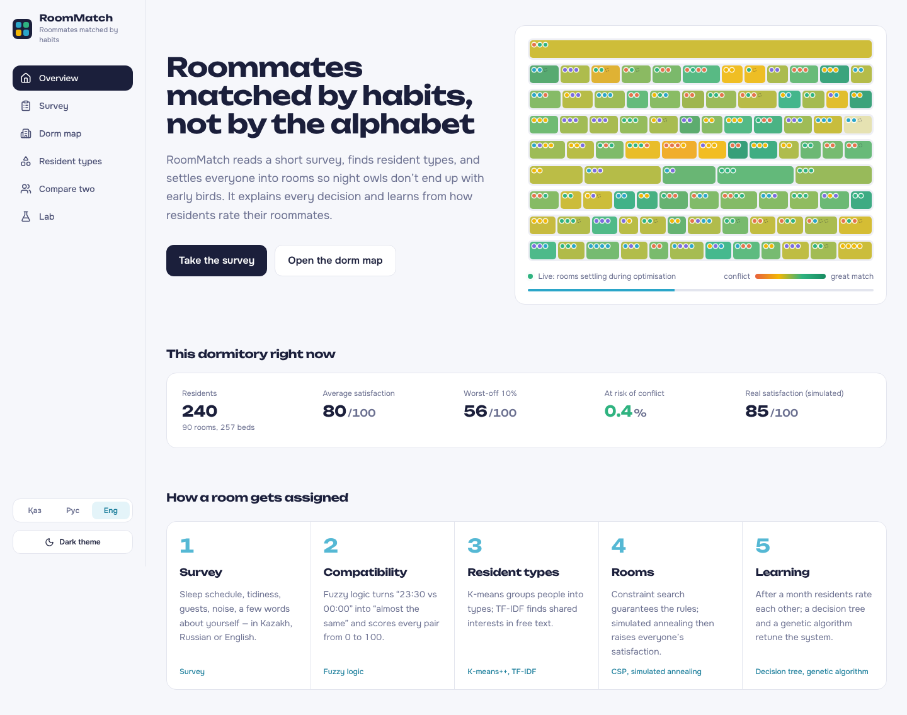
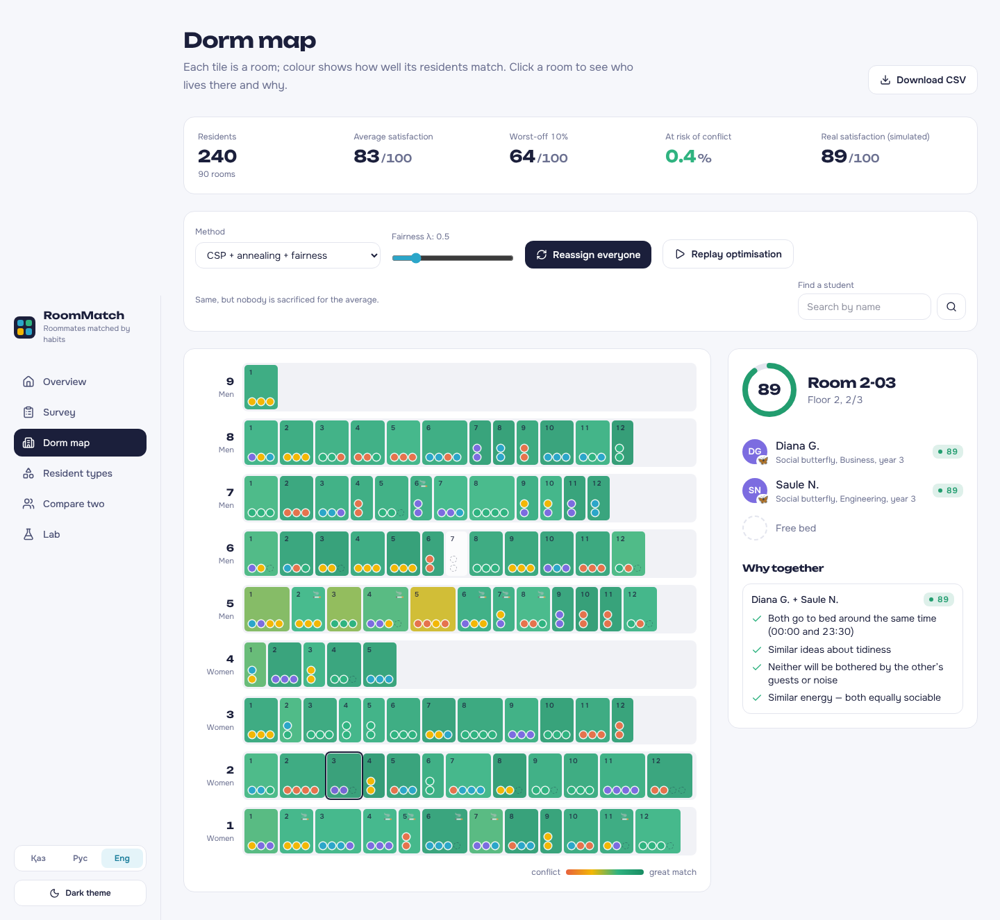
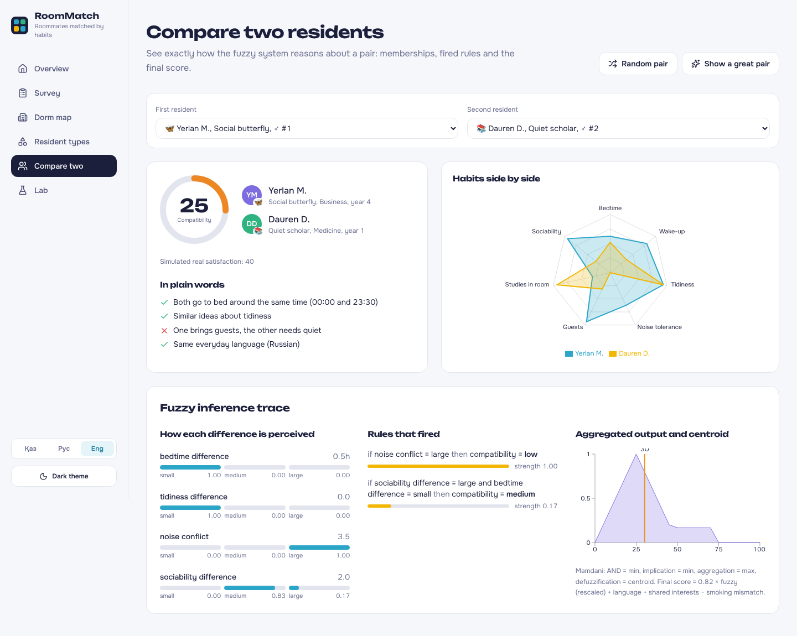
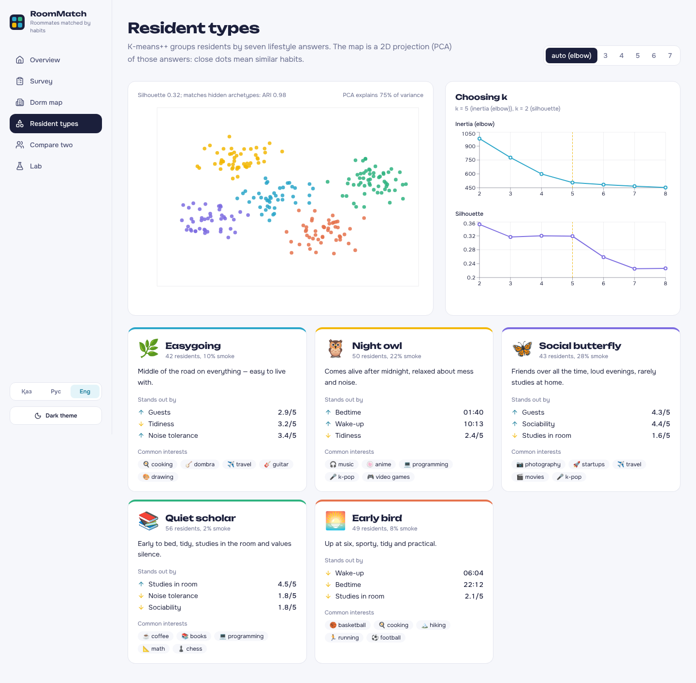
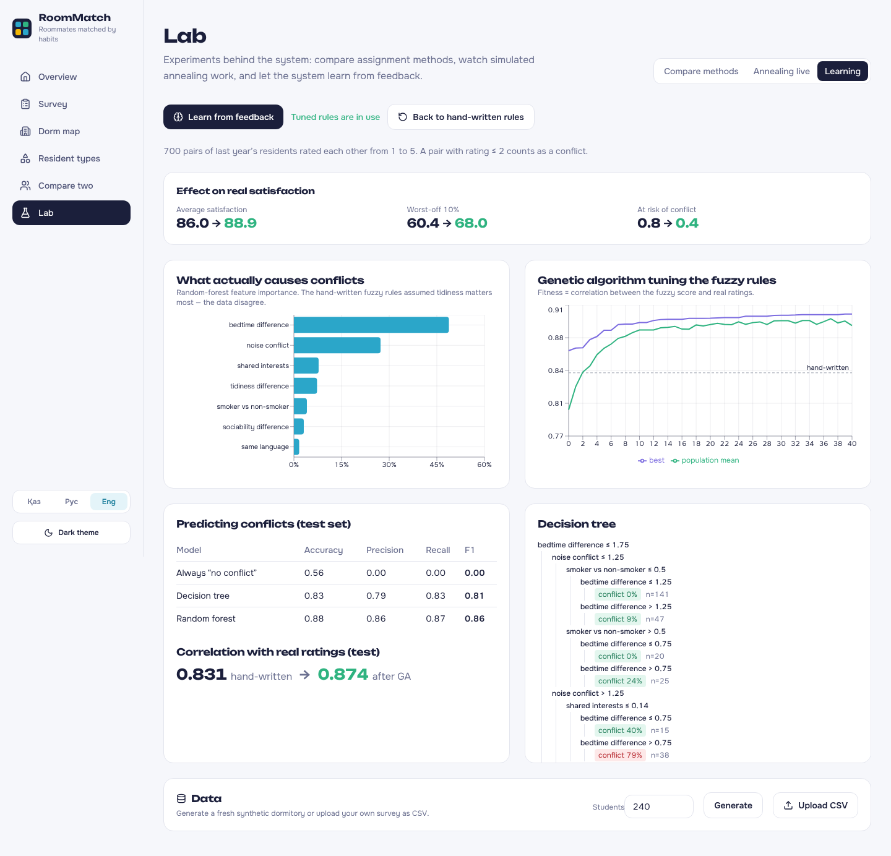
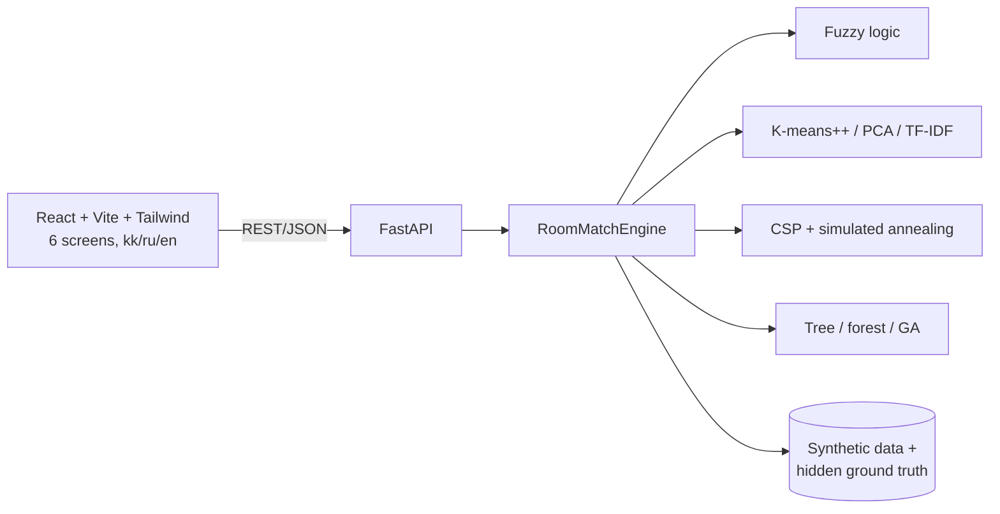

# RoomMatch — dormitory roommates matched by habits, not by the alphabet

**Final project, AI Fundamentals — Team 67.** Repository: https://github.com/Karassvo/Final-AIF-Team-67

**AI Fundamentals course project.** RoomMatch reads a short lifestyle survey, finds resident types, assigns
everyone to rooms so that night owls don't end up with early birds, explains every decision, and learns from
how residents rate their roommates.



## The problem
University dormitories usually assign rooms randomly or alphabetically. Incompatible sleep schedules, noise and
guests are the most common reasons for conflicts and room changes. RoomMatch turns room assignment into an
explainable optimisation problem that respects hard rules (gender floors, capacity, smoking, friend requests).

## Four AI techniques (from different course topics)

| # | Topic | Algorithm(s) | What it does here | Code |
|---|---|---|---|---|
| 1 | Fuzzy logic | Mamdani inference, 17 weighted rules, centroid defuzzification | Scores the compatibility of every pair 0–100 | [`fuzzy.py`](backend/roommatch/algorithms/fuzzy.py) |
| 2 | Unsupervised learning | K-means++ (elbow + silhouette), PCA, TF-IDF + cosine | Resident types and shared interests from free text in kk / ru / en | [`clustering.py`](backend/roommatch/algorithms/clustering.py), [`text.py`](backend/roommatch/algorithms/text.py) |
| 3 | Search & optimisation | CSP backtracking with MRV, forward checking and a global counting constraint; simulated annealing with auto-calibrated temperature and a fairness term | Valid assignment, then optimised assignment | [`assignment.py`](backend/roommatch/algorithms/assignment.py) |
| 4 | Supervised & evolutionary learning | CART decision tree, random forest, genetic algorithm | Predicts conflicts from feedback and retunes the fuzzy rules | [`learning.py`](backend/roommatch/algorithms/learning.py) |

Everything is implemented **from scratch with NumPy** — no scikit-learn, no fuzzy or optimisation libraries.
Detailed explanations and formulas: [`docs/ALGORITHMS.md`](docs/ALGORITHMS.md).

## Results (240 students, 5 random seeds)
"Real" satisfaction is measured with a hidden simulator that the algorithms never see (see *Methodology*).

| Method | Real satisfaction (mean) | Worst-off 10 % | Residents in conflict | Time |
|---|---|---|---|---|
| Random valid assignment | 52.1 | 8.9 | 35.3 % | 0.08 s |
| CSP greedy | 78.6 | 51.5 | 0.8 % | 0.07 s |
| **CSP + simulated annealing** | **87.0** | **63.3** | **0.6 %** | 1.8 s |
| CSP + SA + fairness | 86.0 | 62.0 | 0.8 % | 1.7 s |

* **Learning from feedback:** random forest predicts conflicts with F1 = 0.86 (decision tree 0.81, majority baseline 0.00).
  The genetic algorithm raises the correlation between fuzzy scores and real ratings on the test set from 0.83 to 0.87;
  re-assigning with the tuned rules lifts real satisfaction of the worst-off 10 % from ≈60 to ≈68.
* **CSP ablation:** with random value order, plain backtracking solves 0/3 instances within 3 000 nodes; MRV + forward checking solves 3/3 with zero backtracks.
* **Clustering:** K-means recovers the five hidden lifestyle archetypes with ARI ≈ 0.95–0.98.
* **Scalability:** 1 000 students → fuzzy matrix 2.7 s, CSP 1.4 s, annealing 11 s.

Full tables and charts: [`backend/experiments/results/RESULTS.md`](backend/experiments/results/RESULTS.md).

## Features
* **Survey** — one question per screen in Kazakh, Russian or English, ending with a *resident passport* (your type and the five people you'd get along with). "Move in" places a new student mid-year without reshuffling everyone.
* **Dorm map** — the building floor by floor; room colour = compatibility. Click a room to see who lives there and *why* in plain words. Reassign with any method and replay the optimisation.
* **Resident types** — PCA map of the clusters, elbow and silhouette charts, choose k yourself.
* **Compare two** — the full fuzzy inference trace: memberships, fired rules, aggregated output and centroid.
* **Resident profile** — roommates, best possible matches and a **swap market** (swaps that help without hurting others).
* **Lab** — compare methods, watch simulated annealing live, train the learning module and apply it; generate data or upload your own CSV.
* Three languages, dark theme, keyboard accessible, responsive down to phones; CSV export.

| | |
|---|---|
|  |  |
|  |  |

## Quick start
Requirements: **Python 3.10+** and **Node.js 18+**.

```bash
# macOS / Linux
./run.sh
# Windows
run.bat
```
Then open **http://localhost:8000**. The script installs dependencies, builds the frontend once and serves everything from FastAPI.

### Development mode (hot reload)
```bash
# terminal 1 — API on :8000 (docs at http://localhost:8000/docs)
cd backend
python -m venv .venv && source .venv/bin/activate   # Windows: .venv\Scripts\activate
pip install -r requirements.txt
uvicorn roommatch.api:app --reload

# terminal 2 — UI on :5173 (proxies /api to :8000)
cd frontend
npm install
npm run dev
```

### Tests and experiments
```bash
cd backend
pytest -q                                   # 44 tests: algorithms + API
python experiments/run_experiments.py       # ~3 min, writes experiments/results/
python experiments/run_experiments.py --quick
```
GitHub Actions runs the tests, a quick experiment run and the frontend build on every push.

## Architecture


```
roommatch/
├── backend/
│   ├── roommatch/
│   │   ├── algorithms/      fuzzy.py, clustering.py, text.py, assignment.py, learning.py
│   │   ├── data/            generator.py, ground_truth.py, interests.py
│   │   ├── models.py        Student, Room, Dorm
│   │   ├── features.py      pairwise features
│   │   ├── engine.py        orchestrates the modules
│   │   └── api.py           REST API + serves the built UI
│   ├── tests/               pytest suite
│   └── experiments/         run_experiments.py → results/ (CSV, PNG, RESULTS.md)
├── frontend/src/            pages/, components/, i18n.jsx, api.js
├── data/                    CSV templates for real students and feedback
└── docs/                    ALGORITHMS.md, DEFENSE_QA_ru.md, declarations, screenshots
```

### Main API endpoints
| Method | Path | Purpose |
|---|---|---|
| GET | `/api/summary` | Counts and quality metrics of the current assignment |
| GET | `/api/dorm` | Floors, rooms, residents, optimisation frames |
| GET | `/api/clusters` | Types, PCA points, elbow/silhouette |
| GET | `/api/pair?a=&b=` | Compatibility with full fuzzy trace and reasons |
| GET | `/api/students/{id}` | Profile, roommates, best matches, swap suggestions |
| POST | `/api/assign` | Run `random` / `greedy` / `annealing` / `fair_annealing` |
| POST | `/api/compare` | All methods × several seeds |
| POST | `/api/survey/preview`, `/api/survey` | Resident passport / move in |
| POST | `/api/learn`, `/api/learn/apply` | Train tree, forest, GA; apply tuned rules |
| POST | `/api/upload/students`, `/api/upload/feedback` | Real data as CSV |

Interactive documentation: http://localhost:8000/docs

## Using real data
* Students: [`data/students_template.csv`](data/students_template.csv) — `bedtime` in hours 21–27 (25.5 = 01:30), Likert answers 1–5, `smoker` True/False, `language` kk/ru/en, `friend_id` optional (mutual requests only). Upload in *Lab → Data*.
* Feedback: [`data/feedback_template.csv`](data/feedback_template.csv) — pairwise features + rating 1–5, used by the learning module.

## Methodology and limitations
* We have no real dormitory data, so students are generated from five latent lifestyle archetypes, and a **hidden
  ground-truth satisfaction model** (`data/ground_truth.py`) plays the role of reality. It deliberately disagrees with the
  hand-written fuzzy rules (sleep and noise matter more than tidiness), so learning has something real to discover.
  Algorithms never read it; it is used only for evaluation and to simulate feedback.
* Survey answers are self-reported; real validation would need a pilot with actual residents.
* Simulated annealing is a heuristic: no guarantee of the global optimum (but never worse than its greedy start).
* The fairness term gives a modest gain for the worst-off residents (+2–3 points at λ = 0.25) at a small cost in the mean.

## Team
See [`docs/TEAM_CONTRIBUTION.md`](docs/TEAM_CONTRIBUTION.md) and [`docs/AI_USAGE_DECLARATION.md`](docs/AI_USAGE_DECLARATION.md).
