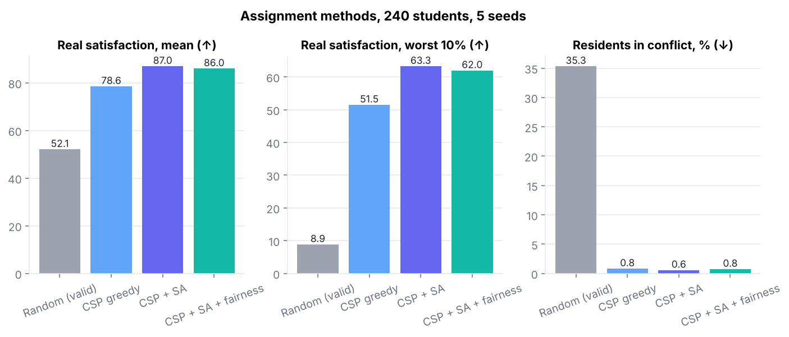
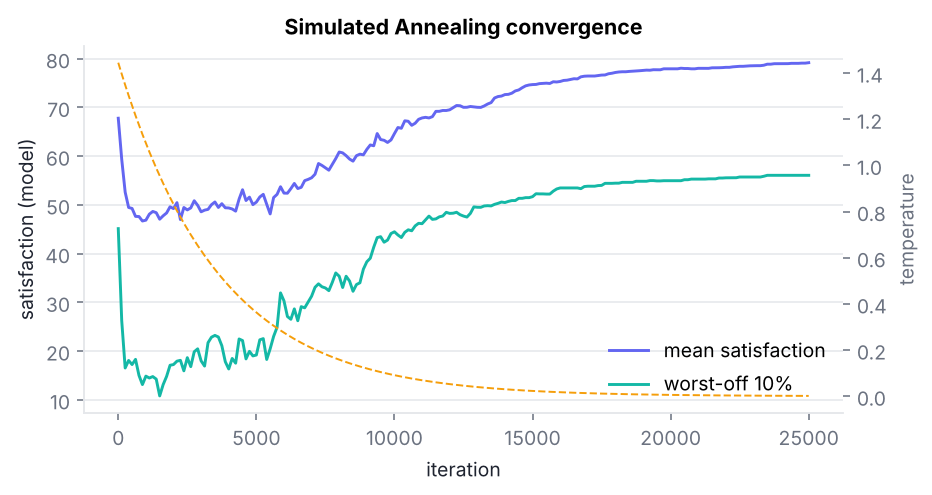
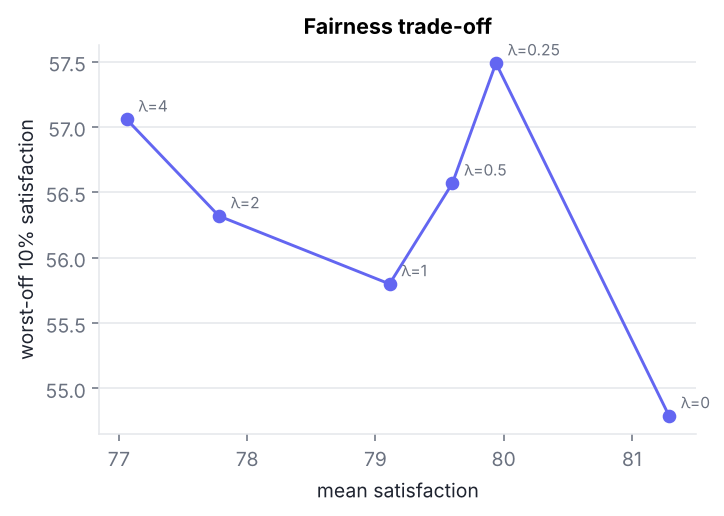
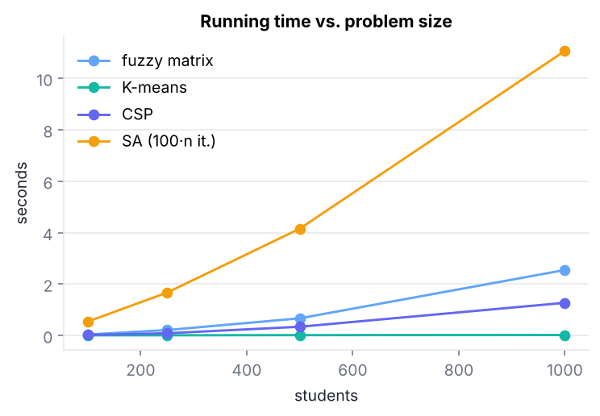
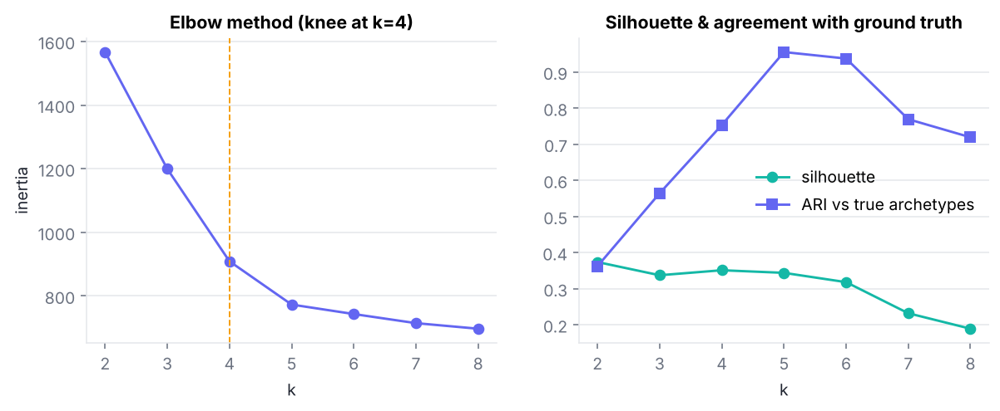
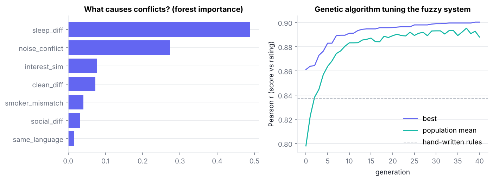

# RoomMatch — experiment results

Generated 2026-11-25 09:48. Features used: sleep_diff, clean_diff, noise_conflict, social_diff, same_language, interest_sim, smoker_mismatch.

## 1. Assignment methods (240 students)

*Model* columns use the fuzzy score the algorithm optimises; *real* columns use the hidden ground-truth satisfaction model that the algorithms never see.

| method | mean_score | worst10_score | conflict_rate | true_mean | true_worst10 | true_conflict_rate | seconds | violations |
|---|---|---|---|---|---|---|---|---|
| Random (valid) | 45.70 ± 1.06 | 12.25 ± 2.80 | 46.08 ± 2.58 | 52.12 ± 1.26 | 8.86 ± 2.50 | 35.34 ± 3.07 | 0.08 ± 0.00 | 0 |
| CSP greedy | 68.13 ± 0.00 | 47.91 ± 0.00 | 0.83 ± 0.00 | 78.57 ± 0.00 | 51.49 ± 0.00 | 0.83 ± 0.00 | 0.07 ± 0.00 | 0 |
| CSP + SA | 81.31 ± 0.26 | 55.51 ± 1.21 | 0.75 ± 0.31 | 87.01 ± 0.32 | 63.27 ± 0.97 | 0.58 ± 0.20 | 1.69 ± 0.08 | 0 |
| CSP + SA + fairness | 79.38 ± 0.41 | 55.98 ± 0.77 | 0.67 ± 0.20 | 86.02 ± 0.30 | 61.98 ± 2.12 | 0.75 ± 0.31 | 1.72 ± 0.03 | 0 |

## 2. Fairness trade-off (λ sweep, mean of 3 seeds)

| lambda | mean | worst10 | min | conflict_rate |
|---|---|---|---|---|
| 0 | 81.29 | 54.79 | 7.69 | 0.83 |
| 0.25 | 79.94 | 57.49 | 4.71 | 0.42 |
| 0.5 | 79.6 | 56.57 | 8.64 | 0.69 |
| 1 | 79.11 | 55.8 | 3.15 | 0.56 |
| 2 | 77.78 | 56.32 | 3.79 | 0.7 |
| 4 | 77.06 | 57.06 | 6.61 | 0.42 |

## 3. CSP ablation (random value order, node limit 3 000)

Forward checking includes the global bed-counting constraint.

| variable_order | forward_checking | solved | nodes | backtracks | seconds |
|---|---|---|---|---|---|
| STATIC | off | 0/3 | 3000 | 2881 | 0.202 |
| STATIC | on | 2/3 | 1165 | 464 | 0.111 |
| MRV | off | 0/3 | 3000 | 2899 | 17.861 |
| MRV | on | 3/3 | 287 | 0 | 0.079 |

## 4. Scalability

| students | rooms | fuzzy_matrix_s | kmeans_s | csp_s | sa_s | greedy_true_mean | sa_true_mean | ari |
|---|---|---|---|---|---|---|---|---|
| 100 | 38 | 0.035 | 0.005 | 0.019 | 0.539 | 74.46 | 81.45 | 0.88 |
| 250 | 92 | 0.21 | 0.007 | 0.085 | 1.667 | 80.0 | 86.31 | 0.955 |
| 500 | 180 | 0.666 | 0.012 | 0.338 | 4.154 | 80.02 | 86.73 | 0.959 |
| 1000 | 365 | 2.546 | 0.017 | 1.27 | 11.07 | 80.02 | 88.71 | 0.94 |

## 5. Clustering (400 students)

| k | inertia | silhouette | ARI_vs_truth |
|---|---|---|---|
| 2 | 1566.5 | 0.3735 | 0.362 |
| 3 | 1199.5 | 0.337 | 0.564 |
| 4 | 909.1 | 0.3508 | 0.753 |
| 5 | 773.1 | 0.3436 | 0.955 |
| 6 | 743.3 | 0.3178 | 0.937 |
| 7 | 714.7 | 0.2317 | 0.769 |
| 8 | 697.2 | 0.1889 | 0.719 |

Elbow picks k = 4; silhouette alone would pick k = 2 (it rewards the coarse early-vs-late split). Agreement with the hidden archetypes peaks at k = 5 (ARI 0.95).

## 6. Learning from feedback

700 simulated rated pairs (525 train / 175 test); conflict = rating ≤ 2 (41% of pairs).

| model | accuracy | precision | recall | f1 |
|---|---|---|---|---|
| Majority baseline | 0.56 | 0.0 | 0.0 | 0.0 |
| Decision tree (CART) | 0.8286 | 0.7901 | 0.8312 | 0.8101 |
| Random forest | 0.88 | 0.859 | 0.8701 | 0.8645 |

Fuzzy score ↔ rating correlation on the **test** set: 0.831 (hand-written) → **0.874** (GA-tuned).

Effect of re-assigning with the tuned fuzzy system (real satisfaction):

|  | true_mean | true_worst10 | true_conflict_rate |
|---|---|---|---|
| before | 86.04 | 60.38 | 0.83 |
| after | 88.9 | 68.02 | 0.42 |

